# Parts catalogue

Every part is a factory registered with `definePart` (see `engine/core/registry.js`). Call it with options
(all optional — the defaults below already look right) and place it with `.at(...)`. Stills are regenerated with
`npm run parts-doc`; each comes from the part's own `demo`.

## Characters

### `pista` — [parts/characters/pista.js](../parts/characters/pista.js)

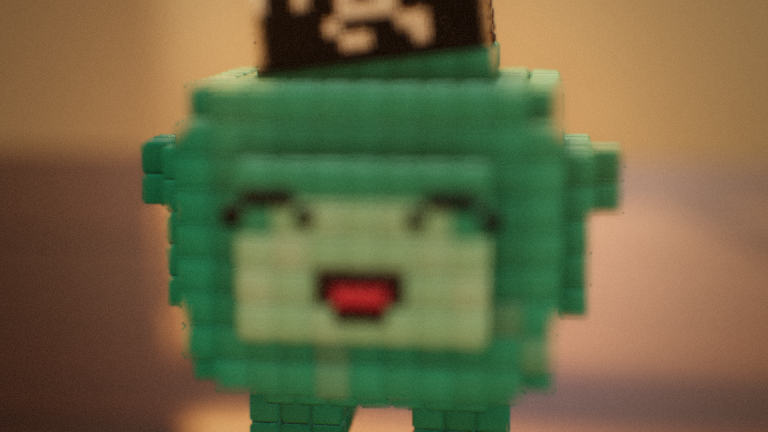

```text
parts/characters/pista.js — PISTA, the hero: a small mint-pistachio voxel creature in a black chust doppi
(four-cornered skullcap with white pepper-pod motifs). Built on the generic creature rig (_rig.js).
  pista({ color: '#4fb8a8', belly: '#a6e6d3', doppi: true, scale: 1, surface: 'cloth' })
Actions (see _rig.js): walk run sprint chase stop turn look face blink smile gasp anticipate jump hop leap land
skid bonk shake peek sniff catch push lift cheer wave eat blush laugh sit balance.
Anchors: center, head, face, top, feet, hands (+ auto front/back/left/right).
```

| option | default |
|---|---|
| `color` | `"#4fb8a8"` |
| `belly` | `"#a6e6d3"` |
| `doppi` | `true` |
| `scale` | `1` |
| `voice` | `1` |
| `surface` | `"cloth"` |

## Props

### `anor` — [parts/props/anor.js](../parts/props/anor.js)

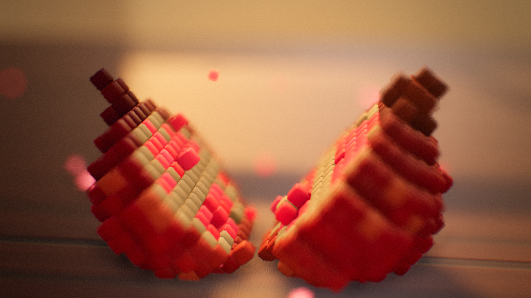

```text
parts/props/anor.js — voxel pomegranate that can wobble, fall, roll (true rolling rotation), be carried,
and crack open into two halves full of glowing ruby arils (+ seed burst).
  anor({ size: 8, seed: 1 })                     size = diameter in cm
  actions: wobble {dur, amount} · fall {to, dur, apex, bounces} · roll {path:[...], speed | dur}
           carry {by:'hero', anchor:'hands'} · crack {burst:true, count} · hop {to, dur, apex}
Sounds it emits by itself: wobble creak, landing thuds, rolling rumble (follows its real speed), crack + burst.
```

| option | default |
|---|---|
| `size` | `8` |
| `seed` | `1` |
| `skin` | `"#a50f26"` |

### `kosa` — [parts/props/kosa.js](../parts/props/kosa.js)

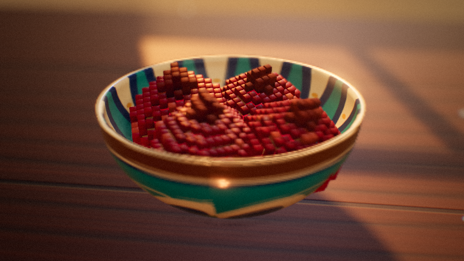

```text
parts/props/kosa.js — deep glazed ceramic bowl (Rishton-style painting), optionally heaped with fruit.
  kosa({ diameter: 20, height: 8.5, fill: 'anor' | null, count: 4, glaze: '#1f9aa8' })
Anchors: rim, pileTop (where one more fruit can sit on the heap), front (table level in front of the bowl).
```

| option | default |
|---|---|
| `diameter` | `20` |
| `height` | `8.5` |
| `glaze` | `"#1f9aa8"` |
| `ink` | `"#123d7a"` |
| `fill` | `null` |
| `count` | `4` |
| `fruitSize` | `7.5` |
| `seed` | `2` |

### `dasturxon` — [parts/props/dasturxon.js](../parts/props/dasturxon.js)

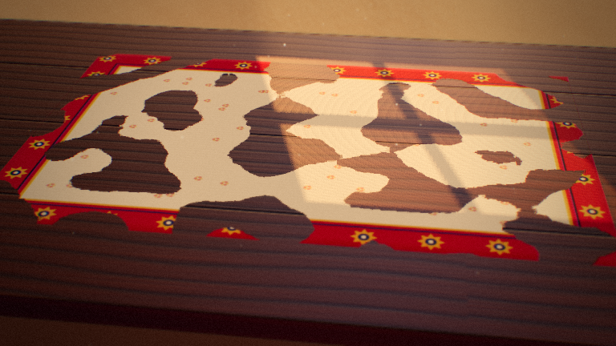

```text
parts/props/dasturxon.js — the tablecloth spread over a low table: ivory field with tiny embroidered
rosettes, a crimson border with gold medallions and indigo rules, draped over the edges with folds.
  dasturxon({ width: 110, depth: 72, overhang: 14, color: '#b3122e' })   (usually built by a set)
The cloth's top surface is at y = 0 of the part; its footprint is width × depth.
```

| option | default |
|---|---|
| `width` | `110` |
| `depth` | `72` |
| `overhang` | `14` |
| `color` | `"#b3122e"` |
| `field` | `"#f3e7cf"` |
| `gold` | `"#e0a93b"` |
| `indigo` | `"#22306e"` |
| `seed` | `1` |

### `kurpacha` — [parts/props/kurpacha.js](../parts/props/kurpacha.js)

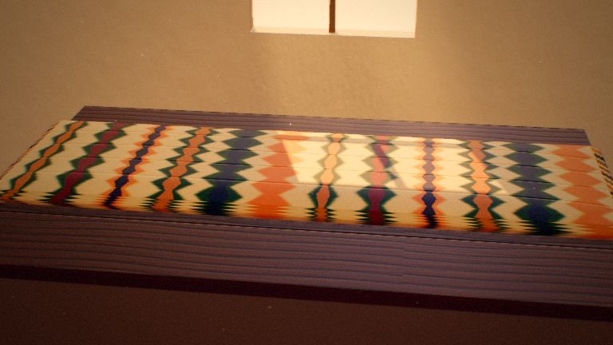

```text
parts/props/kurpacha.js — padded floor mattress (kurpacha) or cushion (yostiq) in khan-atlas ikat silk,
with quilting seams.
  kurpacha({ length: 180, width: 55, thickness: 8, kind: 'mattress' | 'cushion', colors: [...] })
```

| option | default |
|---|---|
| `length` | `180` |
| `width` | `55` |
| `thickness` | `8` |
| `kind` | `"mattress"` |
| `seed` | `1` |
| `colors` | `["#f6e6c8","#c4122f","#f2b632","#1f3f8f","#2f8a4e"]` |

### `choynak` — [parts/props/choynak.js](../parts/props/choynak.js)

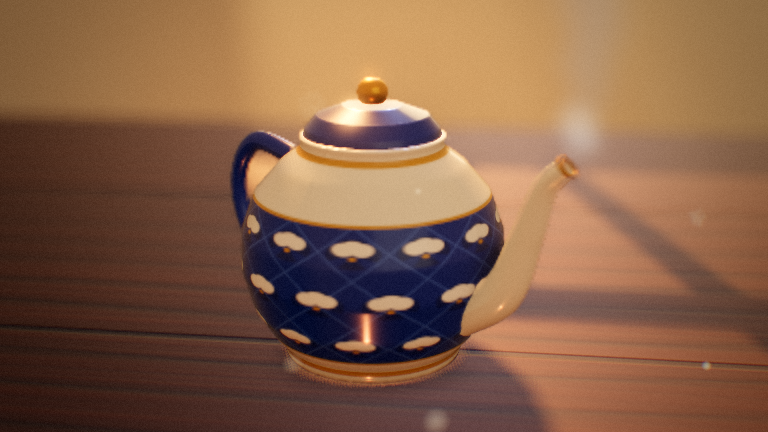

```text
parts/props/choynak.js — porcelain teapot in the cobalt-and-gold "paxta" pattern, with tapered spout,
loop handle, lid and knob; optional steam curling from the spout.
  choynak({ height: 15, steam: true, ink: '#1d3f9a', gold: '#d6a640' })
Anchors: spout (tip), lid (top of knob), handle, side (table level beside the spout), back. Action: wobble.
```

| option | default |
|---|---|
| `height` | `15` |
| `steam` | `true` |
| `ink` | `"#1d3f9a"` |
| `gold` | `"#d6a640"` |
| `ground` | `"#f7f3ea"` |

### `piyola` — [parts/props/piyola.js](../parts/props/piyola.js)

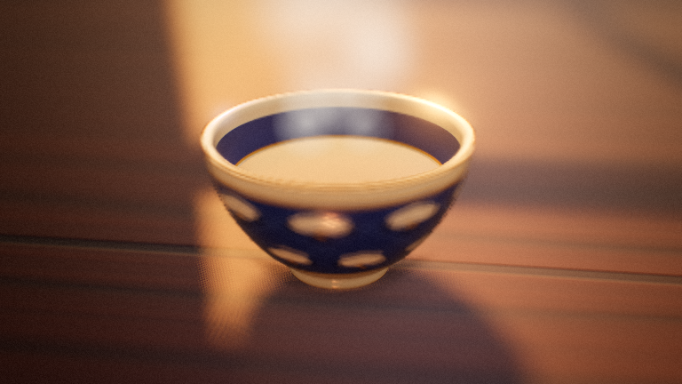

```text
parts/props/piyola.js — handle-less tea bowl in the "paxta" pattern, optionally holding hot green/black tea.
  piyola({ diameter: 9, tea: true, steam: false, ink: '#1d3f9a' })
Anchors: rim, front, side, tea (liquid surface). Action: wobble (rocks and rings when bumped).
```

| option | default |
|---|---|
| `diameter` | `9` |
| `height` | `5` |
| `tea` | `false` |
| `teaColor` | `"#6e300c"` |
| `steam` | `false` |
| `ink` | `"#1d3f9a"` |
| `gold` | `"#d6a640"` |
| `ground` | `"#f7f3ea"` |

### `non` — [parts/props/non.js](../parts/props/non.js)

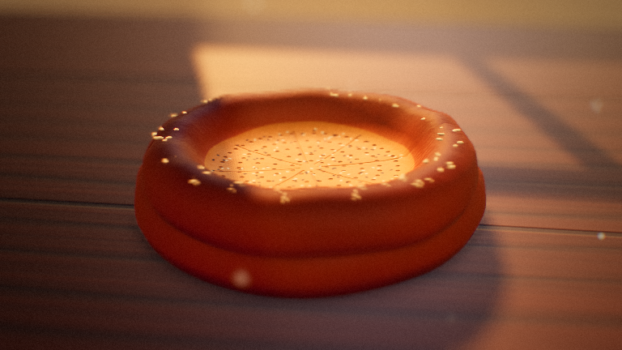

```text
parts/props/non.js — round flatbread: thick glazed rim, thin centre stamped with a chekich dot pattern,
sprinkled with sesame and nigella seeds. Can be stacked.
  non({ diameter: 22, stack: 1, seed: 1, color: '#d79a4b' })
Anchors: top (centre of the top bread), behind (table level behind the stack), front, side.
```

| option | default |
|---|---|
| `diameter` | `22` |
| `stack` | `1` |
| `seed` | `1` |
| `color` | `"#d79a4b"` |

### `lagan-plov` — [parts/props/lagan-plov.js](../parts/props/lagan-plov.js)

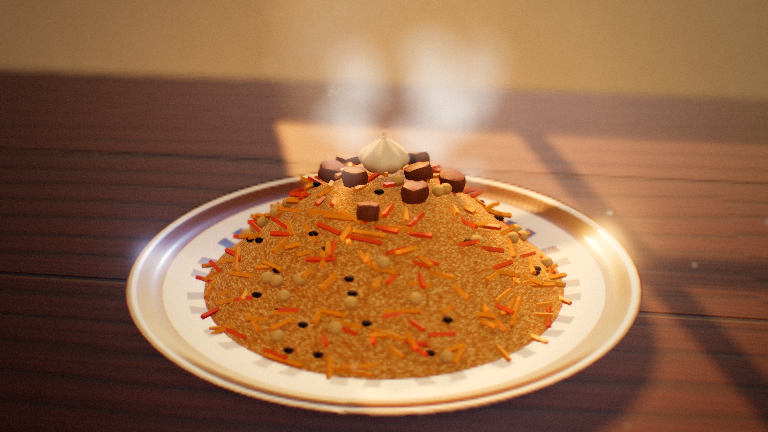

```text
parts/props/lagan-plov.js — a large painted lagan (serving plate) heaped with plov: golden rice dome,
julienned yellow and orange carrots, chickpeas, raisins, lamb pieces and a whole garlic head on top. Steams.
  laganPlov({ diameter: 40, mound: 15, steam: true, seed: 3 })
Anchors: top (garlic), rim (front rim point), front (table level in front), side.
```

| option | default |
|---|---|
| `diameter` | `40` |
| `mound` | `15` |
| `height` | `10` |
| `steam` | `true` |
| `seed` | `3` |
| `glaze` | `"#2a6fb0"` |
| `ink` | `"#14306e"` |

### `qoshiq` — [parts/props/qoshiq.js](../parts/props/qoshiq.js)

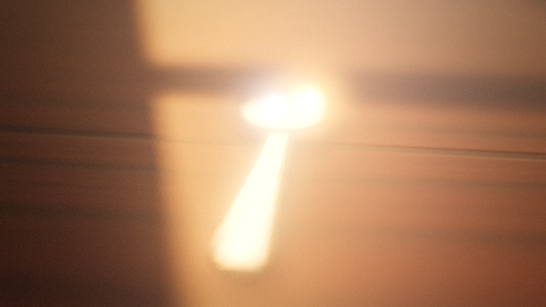

```text
parts/props/qoshiq.js — a spoon lying on the table (metal or wood): shallow oval bowl + tapered handle.
  qoshiq({ length: 14, material: 'silver' | 'wood' })
Anchors: bowl, handle, over (a point just above the middle — handy for hop arcs).
```

| option | default |
|---|---|
| `length` | `14` |
| `material` | `"silver"` |

## Sets

### `studio` — [parts/sets/studio.js](../parts/sets/studio.js)

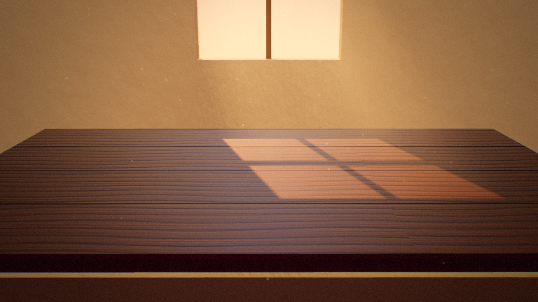

```text
parts/sets/studio.js — neutral tabletop studio: wooden table, plaster room, one window with a cross mullion
and a painted gradient sky outside. Generic stage for part demos and quick tests.
  studio({ wall: '#e6d9c4', table: '#8b5a35', sky: ['#ffcf8a', '#f08a5d', '#6a5a8c'] })
Exposes: surface(x, z), views (wide, close, window), info { window, interior, table } for light rigs.
```

| option | default |
|---|---|
| `wall` | `"#e6d9c4"` |
| `table` | `"#8b5a35"` |
| `sky` | `["#f6c58a","#f3a070","#c77a7a","#5b5a8a"]` |
| `tableSize` | `[180,110]` |
| `windowSize` | `[60,58]` |
| `windowY` | `55` |

### `uzbek-room` — [parts/sets/uzbek-room.js](../parts/sets/uzbek-room.js)

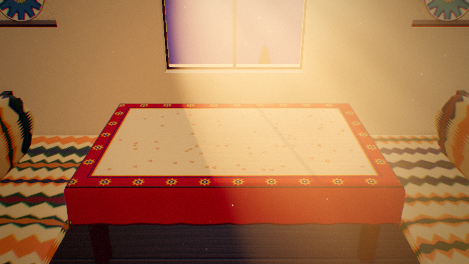

```text
parts/sets/uzbek-room.js — a traditional room at golden hour: a wooden tapchan (raised platform) with a low
xontaxta table under a dasturxon, ikat kurpachas and cushions, thick plaster walls with a carved ganch frieze,
arched niches holding ceramics, a suzani hanging, and an arched window with a girih lattice (it casts patterned
light) looking out on a painted Samarkand skyline — turquoise domes and minarets against the setting sun.
  uzbekRoom({ table: [110, 72], cloth: '#b3122e', sun: [15, 11], window: { width: 72, sill: 6, top: 104 } })
Table-top surface is y = 0. Exposes surface(x, z), views, and info { window, interior, table, sun } for lights.
```

| option | default |
|---|---|
| `table` | `[110,72]` |
| `cloth` | `"#b3122e"` |
| `clothField` | `"#e9d3ad"` |
| `wall` | `"#eadcc4"` |
| `sun` | `[15,11]` |
| `seed` | `5` |
| `window` | `{"width":74,"sill":6,"top":108,"spring":78}` |
| `sky` | `["#3d3470","#8a4a78","#d86f6a","#f6a25c","#ffd08a"]` |

## Lights

### `golden-hour` — [parts/lights/golden-hour.js](../parts/lights/golden-hour.js)

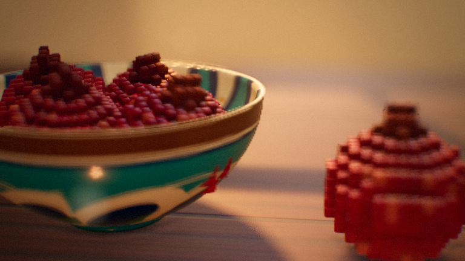

```text
parts/lights/golden-hour.js — low warm sun through the set's window, volumetric shafts with dust, warm fill,
cool sky bounce, warm table bounce, generated IBL with a bright window "soft box", and a warm grade.
  goldenHour({ sunAngle: 'auto' | degrees, sunAzimuth: 'auto' | degrees, sunIntensity: 7, shafts: 1, dust: 450 })
Reads the set's `info.window` / `info.interior` / `info.sun` (any set can provide them); falls back to defaults.
```

| option | default |
|---|---|
| `sunAngle` | `"auto"` |
| `sunAzimuth` | `"auto"` |
| `sunColor` | `"#ffb066"` |
| `sunIntensity` | `5.5` |
| `shadowSoftness` | `3` |
| `fill` | `0.55` |
| `fillSky` | `"#ffe2c4"` |
| `fillGround` | `"#6b3f2a"` |
| `skyBounce` | `0.5` |
| `tableBounce` | `0.35` |
| `shafts` | `1` |
| `shaftColor` | `"#ffbe7a"` |
| `dust` | `450` |
| `envStrength` | `0.55` |
| `exposure` | `1` |

### `night-lamp` — [parts/lights/night-lamp.js](../parts/lights/night-lamp.js)

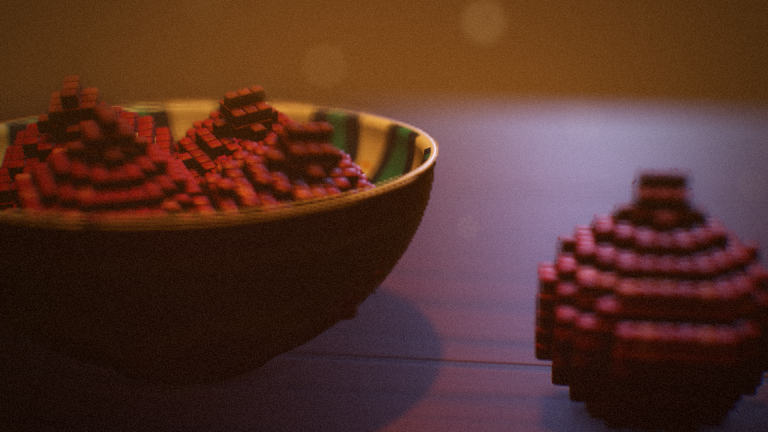

```text
parts/lights/night-lamp.js — evening interior: a hanging lantern pours a warm cone onto the table (volumetric,
with shadows), cool moonlight leaks through the window, deep blue ambient.
  nightLamp({ at: [0, 70, 0], target: [0, 0, 0], color: '#ffb35a', intensity: 900, angle: 38, moon: 0.35 })
Works with any set; reads info.window (moon direction) and info.interior (shaft volume) when present.
```

| option | default |
|---|---|
| `at` | `[0,70,0]` |
| `target` | `[0,0,0]` |
| `color` | `"#ffb35a"` |
| `intensity` | `9000` |
| `angle` | `40` |
| `penumbra` | `0.55` |
| `moon` | `0.35` |
| `lantern` | `true` |
| `shafts` | `1` |
| `dust` | `250` |

### `overcast` — [parts/lights/overcast.js](../parts/lights/overcast.js)

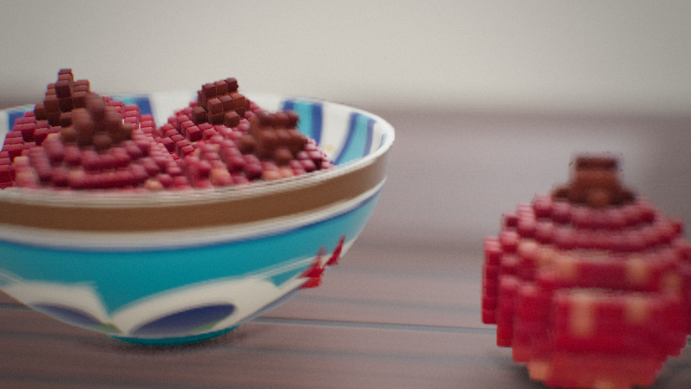

```text
parts/lights/overcast.js — soft, cool daylight from a cloudy sky: big wrap-around fill, a very soft key from
the window side, no visible shafts, gentle low-contrast grade.
  overcast({ intensity: 1, tint: '#dfe6f0' })
```

| option | default |
|---|---|
| `intensity` | `1` |
| `tint` | `"#dfe6f0"` |
| `dust` | `120` |

